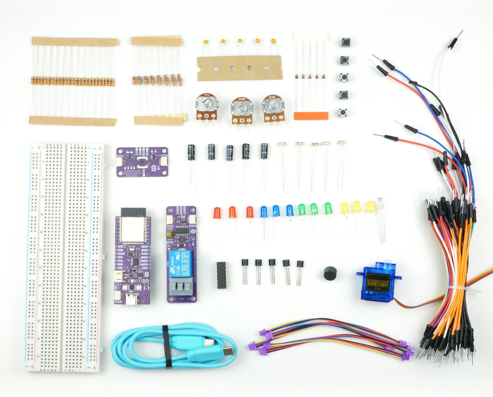

# Inventor kit, Basic: Arduino examples

Arduino sketches for the Basic manual of the Soldered Inventor kit, built around the
[NULA DeepSleep ESP32-S3](https://soldered.com/product/nula-deepsleep-esp32-s3-board/).

Every program in the manual is in this repository as the same text, so you never have to retype one.

## What is on the board

An ESP32-S3 with a CH340 USB-serial chip, an onboard WS2812B RGB LED, a PCF85063A real-time clock and a Qwiic
connector. Deep-sleep current is in the single microamps.


## Getting started

### 1. Install the board

1. In the Arduino IDE, open **File -> Preferences** and add this URL to *Additional boards manager URLs*:
   ```
   https://espressif.github.io/arduino-esp32/package_esp32_index.json
   ```
2. Open **Tools -> Board -> Boards Manager**, search for `esp32` and install **esp32 by Espressif Systems**.
3. Select **Tools -> Board -> ESP32 Arduino -> Soldered NULA DeepSleep ESP32S3**.

### 2. Install the CH340 driver

The USB-C port runs through a CH340. Without its driver the board never appears as a serial port, so there is
nothing to pick in **Tools -> Port**. Windows and macOS both need it; on Linux it is already in the kernel.

Driver and troubleshooting: [docs.soldered.com/ch340-drivers](https://docs.soldered.com/ch340-drivers)

### 3. Install the libraries

Open **Tools -> Manage Libraries** and install these three, all by Soldered Electronics:

| Library | Needed by | Header it provides |
| --- | --- | --- |
| **Soldered TMP117** | 5.1, 6.2, 7.1, 7.2, 7.4 | `Soldered-TMP117.h` |
| **Soldered Library for Relays** | 5.2, 7.1, 7.4 | `Relays-SOLDERED.h` |
| **Soldered PCF85063A RTC Arduino Library** | 6.1, 7.2 | `PCF85063A-SOLDERED.h` |

Sections 0 to 4 need no libraries at all.

### 4. Open a program

Each program lives in its own folder, named like the file inside it. Open it with **File -> Open** and follow the chapter that uses it.

## The programs

Every program here is the same text as on its page in the manual, so you can copy it from either place. They are in the order the chapters teach them.


### 1. Run your first program

| Program | What it does |
| --- | --- |
| 0.0_First_Light.ino | The smallest thing the board can do: light the RGB LED that is already on it. |

### 2. Switch things on and off

| Program | What it does |
| --- | --- |
| 0.1_First_Blink.ino | The first example of the kit. |
| 0.1_Two_LEDs_Taking_Turns.ino | Two LEDs on IO38 and IO39 taking turns. |
| 0.3_Traffic_Lights.ino | A lit spot walking along five LEDs on IO38 to IO42. |
| 0.3_Dark_Running_Light.ino | A dark spot walking along five lit LEDs on IO38 to IO42. |
| 0.3_Traffic_Lights.ino | A car traffic light on IO38, IO39 and IO40, the four-phase kind: red, red and yellow together, green, yellow, and round again. |

### 3. Read a button

| Program | What it does |
| --- | --- |
| 2.1_Floating_Button.ino | Reads a button on a pin that nothing is holding, so the reading drifts. |
| 2.1_External_Pull_Up.ino | Reads a button on a pin held HIGH by a 10 kOhm pull-up resistor to 3V3. |
| 2.1_External_Pull_Down.ino | Reads a button on a pin held LOW by a 10 kOhm pull-down resistor to GND. |
| 2.1_Internal_Pull_Up.ino | Reads a button using the pull-up resistor that is built into the chip. |
| 2.1_Button_Bounce.ino | Samples a button every 50 us after a press and prints how long it rattles for. |

### 4. Measure with an analog pin

| Program | What it does |
| --- | --- |
| 0.2_Reading_A_Potentiometer.ino | Reads a potentiometer and prints it two ways at once, as raw ADC counts and as millivolts, so the Serial Plotter draws both as traces you can watch while you turn the knob. |
| 2.3_Photoresistor_Resistance.ino | Measures the photoresistor's own resistance from the voltage at the junction of the divider, so you can pick a fixed resistor to pair it with. |
| 2.3_Photoresistor_Hysteresis.ino | Calibrates the light range, then switches an LED on two thresholds, so light sitting right on the switching point cannot make it flicker. |
| 2.3_Photoresistor_Single_Threshold.ino | Calibrates the light range, then switches an LED on one threshold, so you can watch it flicker when the light sits right on the switching point. |
| 2.3_Photoresistor_Percent.ino | Calibrates the light range over ten seconds, then reports the light as a percentage of that range. |

### 5. Fade an LED

| Program | What it does |
| --- | --- |
| 1.2_Gamma_Fading_And_RGB_Colour_Mixing.ino | Ramps an LED linearly and then with a gamma curve so you can compare them back to back. |

### "6. Project: a night light"

| Program | What it does |
| --- | --- |
| 1.3_Night_Light.ino | A night light that fades up as the room gets dark, combining the photoresistor divider from T10 with the gamma-corrected PWM from T12. |

### 7. Capacitors, diodes and transistors

| Program | What it does |
| --- | --- |
| 3.1_Measuring_An_RC_Time_Constant.ino | Charges a capacitor through a resistor, captures the rise into a buffer, and prints the measured time constant next to the calculated one. |
| 3.2_Diode_Forward_Voltage.ino | Logs a diode's forward voltage against the current through it while you turn a pot, so you can see that the drop is a curve rather than the 0.7 V everybody quotes. |
| 3.3_Transistor_Base_Resistor_And_Saturation.ino | Sweeps the base drive of an NPN transistor with the potentiometer and measures load current, base current and the ratio between them. |

### 8. Buzzers, servos and shift registers

| Program | What it does |
| --- | --- |
| 4.3_Driving_A_Buzzer_Through_A_Transistor.ino | Drives a passive buzzer through an NPN transistor from the + row, with a flyback diode. |
| 4.3b_Buzzer_Loudness_From_A_Pot.ino | Drives a passive buzzer through an NPN transistor at one fixed frequency, with a pot setting the duty cycle and so the loudness. |
| 4.3c_Buzzer_Held_Steady.ino | Drives the pin of a passive buzzer's transistor steadily high, to show that a steady voltage makes no sound. |
| 4.3d_Buzzer_Duty_Steps.ino | Holds a passive buzzer at its resonant frequency and steps the duty cycle through 5, 10, 25 and 50 %. |
| 4.2_Servo_Pulses_Without_A_Library.ino | No servo library. |
| 4.1a_Eight_LEDs_From_Three_Pins.ino | Drives eight LEDs from a 74HC595, times three different ways of getting a byte into it, and then walks a single lit bit across the row. |

### 9. Qwiic modules

| Program | What it does |
| --- | --- |
| 5.1_Scanning_The_Bus_And_Reading_Temperature.ino | Scans the I2C bus and prints every address that answers, so you can see what is really connected. |
| 5.1_Scanning_The_Bus_And_Reading_Temperature.ino | Reads temperature from the TMP117 twice a second and checks every reading is a real one. |
| 5.2_Relay_Switching_With_Hysteresis_And_Lockout.ino | Switches a Qwiic relay from a pot. |
| 5.2_Relay_Switching_With_Hysteresis_And_Lockout.ino | Switches a Qwiic relay from a pot, with a hysteresis band but no minimum interval between switches. |

### 10. Deep sleep and waking up

| Program | What it does |
| --- | --- |
| 6.1_Deep_Sleep_Wake_Sources_And_RTC_Memory.ino | Two counters show what survives deep sleep and what does not. |
| 6.1_Deep_Sleep_Button_Wake.ino | Two counters show what survives deep sleep and what does not. |
| 6.1_Deep_Sleep_Timer_Or_Button_Wake.ino | Two counters show what survives deep sleep and what does not. |
| 6.2_Checking_A_Sensor_Alert_Flag.ino | The TMP117 keeps converting on its own and decides for itself when the temperature has left a band, then latches a flag. |

### 11. Four projects

| Program | What it does |
| --- | --- |
| 7.1_Thermostat_With_Relay_And_Alarm.ino | A cooling thermostat. |
| 7.2_WiFi_Temperature_Logger.ino | Sends a message every minute, the moment the temperature moves a full degree, or whenever the button is pressed. |
| 7.3_Two_Sensor_Sun_Tracker.ino | Two photoresistors either side of a paper strip turn a servo needle towards the brighter one, with a dead band and a rate limit to keep it from shuffling on its own noise. |
| 7.4_Bench_Controller.ino | Five jobs sharing one loop, none of them waiting for the others. |

## Continuous integration

Every example is compiled for the NULA DeepSleep ESP32-S3 on every push by the
[Compile examples](.github/workflows/compile-examples.yml) workflow, so anything on the main branch is known to
build.

The Advanced manual has its own repository with longer programs and bigger projects: [Soldered-NULA-Inventor-kit-Arduino-project-examples-Advanced](https://github.com/SolderedElectronics/Soldered-NULA-Inventor-kit-Arduino-project-examples-Advanced).

### About Soldered


At Soldered, we design and manufacture a wide selection of electronic products to help you turn your ideas into acts and bring you one step closer to your final project. Our products are intented for makers and crafted in-house by our experienced team in Osijek, Croatia. We believe that sharing is a crucial element for improvement and innovation, and we work hard to stay connected with all our makers regardless of their skill or experience level. Therefore, all our products are open-source. Finally, we always have your back. If you face any problem concerning either your shopping experience or your electronics project, our team will help you deal with it, offering efficient customer service and cost-free technical support anytime. Some of those might be useful for you:

- [Web Store](https://www.soldered.com/shop)
- [Tutorials & Projects](https://soldered.com/learn)
- [Documentation](https://docs.soldered.com)
